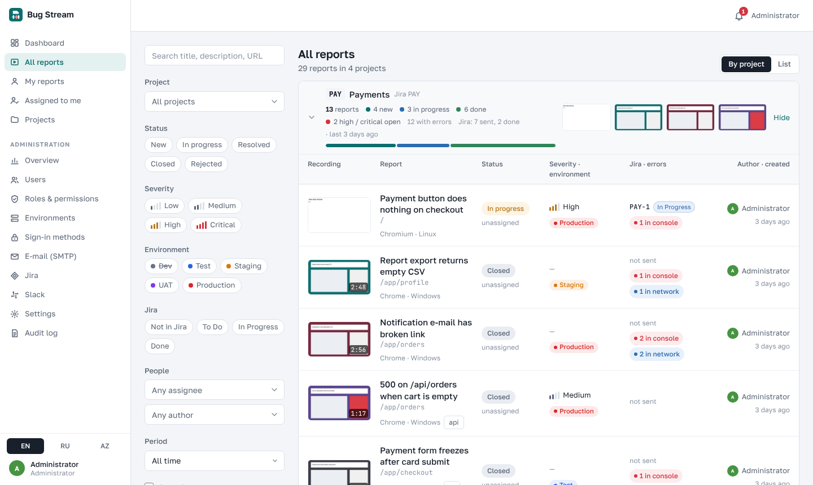
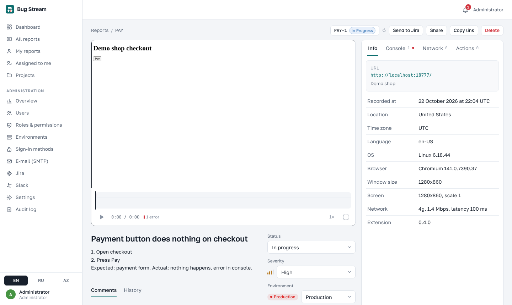
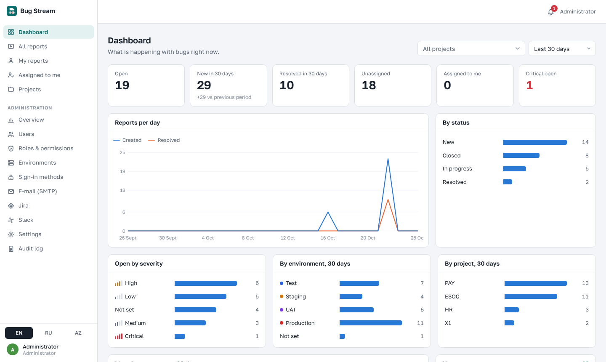
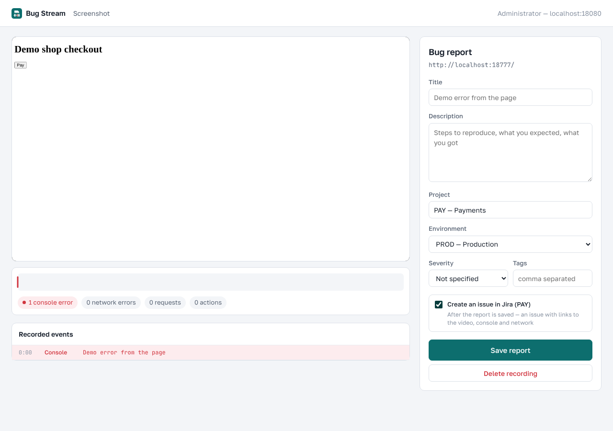
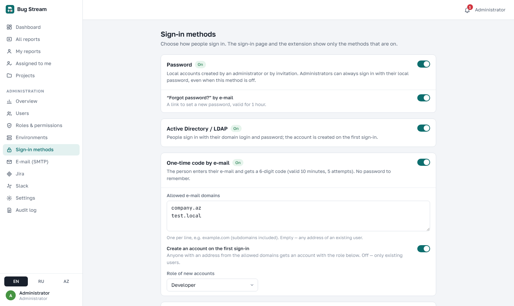

# Bug Stream

**Self-hosted bug reporting for teams.** One click in Chrome records what went wrong — the tab video, a screenshot or
the last 2 minutes of the page — together with the console, network requests and user actions, and turns it into a
report with a link. Reports live on **your own server**, can be sent to **Jira Cloud** and announced in **Slack**.
Open source and built to work inside closed corporate networks.



## Features

- **Chrome extension** (Manifest V3): record the tab, take a screenshot or save the last 2 minutes (instant replay, rrweb),
  with console, `fetch` / XHR requests (headers and bodies), clicks and input, browser and page info.
- **Site widget** — one JS file: a "Report a bug" button inside your own web app, no extension needed.
- **Report page**: video / replay player with an event track, DevTools-like Console · Network · Actions · Info tabs,
  comments with @mentions, history, assignee, status, severity, environment, tags.
- **All reports** grouped by project or as a list with filters; dashboard with charts.
- **Jira Cloud**: sync projects, link them, create issues on behalf of each user (personal API token),
  issue types per project with a safe fallback, **issue status synced back** into the reports list.
- **Slack**: new reports to a channel per project, personal notifications as direct messages.
- **Sign-in methods**: local passwords, **Active Directory / LDAP**, one-time **e-mail codes**; invitations and password
  reset through your own SMTP server.
- **Roles & permissions**, admin panel, audit log, environments (DEV / TEST / STAGE / PROD or your own).
- **Public share links** with expiry and revocation (can be switched off).
- **English, Russian, Azerbaijani** interface.
- Runs with **Docker Compose**; works offline / behind a corporate proxy (Nexus supported).

| | |
|---|---|
|  |  |
|  |  |

## How it works

```
 Chrome extension ──┐                          ┌─> Jira Cloud (issues, status sync)
                    ├─> nginx ──> Spring Boot ─┼─> Slack (channel + direct messages)
 Site widget ───────┘    │            │        └─> SMTP, AD / LDAP (optional)
                         │            └─> PostgreSQL + files on disk (video, screenshots)
                   React site (reports, admin)
```

## Quick start (local, about 10 minutes)

Works on **Windows, macOS** (Intel and Apple Silicon) and **Linux**. You need **Docker** (Docker Desktop on Windows /
macOS, or Docker Engine 24+ with Compose v2 on Linux), **Git** and **Google Chrome**.

**1. Get the code and create the settings file** — random passwords are generated for you:

```bash
git clone https://github.com/KpoJIuk06/bug-stream.git
cd bug-stream/server
sh scripts/init-env.sh                # Linux / macOS — press Enter for "localhost"
```
```powershell
cd bug-stream\server
powershell -ExecutionPolicy Bypass -File scripts\init-env.ps1     # Windows
```
The script prints the administrator e-mail and password — keep them.

**2. Start the server** — the first build downloads dependencies and takes several minutes:

```bash
docker compose up -d --build
docker compose logs -f backend      # wait for "Started BugTrackApplication", then Ctrl+C
```

**3. Open http://localhost** and sign in as the administrator from step 1. Create a project
(**Projects → New project**) and on its **Services** tab add the address of the site you test as a host pattern
(for example `localhost:3000` or `test.example.com`) — reports from that site are filed into the project automatically.

**4. Load the extension** — a ready build for `http://localhost` is in `extension/dist`:
`chrome://extensions` → turn on **Developer mode** → **Load unpacked** → choose the `extension/dist` folder.
Pin the Bug Stream icon, sign in with the same account, open any site and press **Record tab**
(`Alt+Shift+R` on Windows / Linux, `⌥⇧R` on macOS).

On macOS Chrome records only the browser tab, so no "Screen Recording" permission is needed in System Settings.

To stop: `docker compose down` — the data stays (database in a Docker volume, files in `server/storage`).
Port 80 is busy? Set `HTTP_PORT=8080` and `APP_PUBLIC_URL=http://localhost:8080` in `server/.env`, and use
`http://localhost:8080` as the server address in the extension.

## Running it for a team

| Step | Read |
|---|---|
| Server on a subdomain with HTTPS, backups, updates, all settings | [server/README.md](server/README.md) |
| Builds behind a corporate proxy / Nexus | [server/docs/nexus.md](server/docs/nexus.md) |
| Extension with your server address; rollout by group policy or Chrome Web Store | [extension/README.md](extension/README.md), [extension/docs/deploy.md](extension/docs/deploy.md) |
| Widget in your own web app | [widget/README.md](widget/README.md) |
| What is recorded and where data goes (for a security review) | [extension/SECURITY.md](extension/SECURITY.md), [widget/SECURITY.md](widget/SECURITY.md) |

In short: `sh scripts/init-env.sh bugs.example.com` → put the site behind HTTPS (your load balancer, or a certificate in
`server/certs/`) → `docker compose up -d --build` → in **Administration** set up sign-in methods, SMTP, Jira and Slack →
build the extension with your address: `cd extension && npm ci && BUGSTREAM_SERVER=https://bugs.example.com npm run build`.

## Repository layout

```
server/
  backend/        Java 25, Spring Boot 4.1, Flyway migrations (PostgreSQL 18)
  frontend/       React 19 + Vite site and nginx config; public/widget/bug-stream.js
  scripts/        init-env.sh / init-env.ps1 — create .env with random secrets
  docs/           Nexus, ingest API (OpenAPI)
  docker-compose.yml, .env.example
extension/        Chrome extension (TypeScript, esbuild); dist/ is a ready build for http://localhost
widget/           site widget (TypeScript, esbuild); dist/bug-stream.js + SRI hash
docs/images/      screenshots
```

## Development

- Backend: `cd server/backend && mvn spring-boot:run` — needs PostgreSQL 18; variables are listed in
  `src/main/resources/application.yml` (`DB_URL`, `DB_USER`, `DB_PASSWORD`, `JWT_SECRET`, …).
- Site: `cd server/frontend && npm ci && npm run dev` — `/api` is proxied to `http://localhost:8080` (`API_URL` to change).
- Extension / widget: `npm ci && npm run build` in their folders (`npm run watch` for the extension).
- Translations: the English text is the key; Russian and Azerbaijani live in `server/frontend/src/i18n/`
  and `extension/src/shared/i18n-dict.ts`.

See [CONTRIBUTING.md](CONTRIBUTING.md) and [CHANGELOG.md](CHANGELOG.md).

## Security

Reports can contain everything a page shows and sends, including request bodies. Run it on a server you control,
restrict who can sign in and, for the extension, restrict the sites it works on
([extension/docs/deploy.md](extension/docs/deploy.md)). Report vulnerabilities privately — see [SECURITY.md](SECURITY.md).

## License

[Apache License 2.0](LICENSE) — free to use, change and run inside your company, including commercially;
keep the license and copyright notices when you redistribute it.

Third-party parts keep their own licenses: the Golos Text and JetBrains Mono fonts — SIL Open Font License 1.1
(`extension/static/fonts/OFL-*.txt`); libraries installed by Maven and npm — their licenses are listed in their packages
(`mvn dependency:tree`, `npm ls`).
